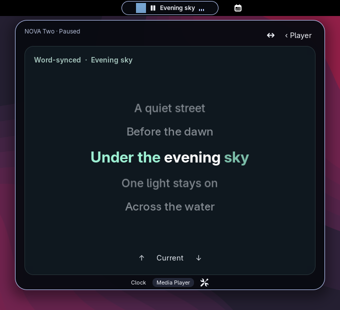

# NOVA Island

NOVA Island is a native GNOME Shell 51 extension for Wayland. Its centered pill shows the clock or the selected media player. Hover to open the preview beneath the bar. With the expanded default set to Automatic, it opens on Time when available. Explicit defaults, manual module selections, and media or notification event previews retain their own selection. Click to pin it, then click again to collapse it. Use **Ctrl+Alt+Tab** to focus NOVA Island, **Enter** or **Space** to activate it, **Down** to reach preview controls, and **Escape** to collapse it.

The calendar icon opens GNOME’s original calendar and notifications menu. It sits beside the pill when the native date menu is centered. When the date menu is in a side group, as it is by default in GNOME Classic, the calendar icon stays in that group. Disabling NOVA restores the stock clock.

## Install

Install the 0.5.4 bundle from the project directory with Fish. The bundle uses the existing extension UUID and preserves GSettings values.

```fish
gnome-extensions install --force ./dist/nova-island@fromapurbo-0.5.4.shell-extension.zip
set -l data_dir ~/.local/share
if set -q XDG_DATA_HOME; and test -n "$XDG_DATA_HOME"
    set data_dir "$XDG_DATA_HOME"
end
install -Dm644 applications/nova-island-settings.desktop "$data_dir/applications/nova-island-settings.desktop"
```

Log out and back in to load the updated JavaScript in the Wayland session. Then enable NOVA and open preferences.

```fish
gnome-extensions enable nova-island@fromapurbo
gnome-extensions prefs nova-island@fromapurbo
```

Open preferences from the gear in the expanded island, the NOVA Island Settings launcher, or GNOME Extensions. The launcher installation above is optional.

To rebuild the bundle from this directory, run `gnome-extensions pack --force --extra-source=src --extra-source=applications --extra-source=LICENSE --extra-source=fonts --extra-source=tools --extra-source=INSTALL.txt .`.

## Customization Studio

The Appearance, Layout, Motion, Modules, Media, and Presets pages apply changes immediately. The preferences window includes a sample of the compact and expanded clock with the current type, palette, border, shadow, and glass treatment. Choose NOVA Dark, Midnight, Frosted Glass, Minimal Black, Aurora, or Custom. Glass uses a translucent color, border, and shadow.

Presets save the current configuration in GSettings or export it as versioned JSON. NOVA checks file size, keys, types, choices, and ranges before applying an import. **Reset** restores defaults and keeps saved presets. The compact dimensions are capped by the available panel space. Layout settings move the expanded preview while the pill stays centered.

## Media Player

The media runtime uses the GJS Gio, libsoup 3, and GdkPixbuf introspection libraries provided by the GNOME desktop. Lyrics are the only fixed external service. HTTPS artwork follows URLs supplied by players when enabled.

NOVA discovers players advertising MPRIS on the session D-Bus. Clock remains available in the module settings and through the preview’s module tabs when both modules are enabled. Expanded media includes title, artist, album, cover, track time, and the player’s supported playback controls. The play button toggles playback, and the seek buttons move ten seconds. The player switch cycles available players and remembers the selection. When that player leaves, NOVA uses the configured default if available, then prioritizes playing clients and the order configured in **Media → Players**. A web tab appears only when its browser exposes an MPRIS player.

Local artwork supports PNG, JPEG, and WebP. Remote HTTPS artwork is enabled by default. An explicitly saved off setting still takes precedence. Disable it or clear the in-memory cache in **Media → Expanded media**. The compact pill shows three visualizer bars during playback. The lyrics header shows artwork, title, artist, album, sync status, and four bars during playback. Automatic track previews and lyrics are off by default. Enable lyrics in **Media → Lyrics**, then use the lyrics button on the expanded media view. While lyrics are enabled, NOVA looks up each selected track on LRCLIB. The Lyrics button shows lookup status and switches between lyrics and playback controls. It uses timestamps when available and otherwise shows plain lyrics. [MPRIS player specification](https://specifications.freedesktop.org/mpris/latest/Player_Interface.html) · [LRCLIB API](https://lrclib.net/docs)

### Expanded lyrics in 0.3.2

Enable **Media → Lyrics**, open the expanded player, and select **Lyrics**. The panel opens at 620 × 540 logical pixels by default and fits the monitor work area. The heading identifies the timing available for the selected recording.

| Indicator | Playback behavior |
| --- | --- |
| Word-synced | Each supplied word onset advances the highlight inside the original line. Explicit end times release it during gaps. |
| Synced | The player position selects the timestamped LRC line. |
| Plain | Read the full text in a manually scrollable view. |

Use **↑** and **↓** to browse timed lines while the track continues. **Current** returns to the playing line. Preferences include separate sizes for plain text, current and surrounding lines, line and word colors, layout, transitions, and a live sample. The reduced-motion switch also applies to the rest of the island.



If a center indicator or a crowded panel blocks NOVA, GNOME’s clock remains visible. To also show a separate pill below the bar, enable **Panel placement → Floating fallback** in preferences. The fallback is off by default. Check placement and the reason for a fallback or unavailable slot in the journal.

```fish
journalctl --user -b --grep '\[NOVA Island\]'
```

## Test

Validate the schema and run the Wayland smoke test from the project directory. The smoke test packages and installs the extension into the test tool’s temporary XDG directories. The compositor uses a separate Wayland socket, D-Bus session, and settings backend.

```sh
find src tests -name '*.js' -exec node --check {} \;
node --check extension.js
node --check prefs.js
glib-compile-schemas --strict --dry-run schemas
test_dir=$(mktemp -d)
glib-compile-schemas --strict --targetdir="$test_dir" schemas
GSETTINGS_SCHEMA_DIR="$test_dir" GSETTINGS_BACKEND=memory gjs -m tests/studio.js
dbus-run-session -- gjs -m tests/media.js
gjs -m tests/enhancements.js
mkdir -m 700 "$test_dir/runtime"
gnome-extensions pack --extra-source=src --extra-source=applications --extra-source=LICENSE --extra-source=fonts --extra-source=tools --extra-source=INSTALL.txt --out-dir="$test_dir" .
unzip -tq "$test_dir/nova-island@fromapurbo.shell-extension.zip"
env -u DISPLAY -u WAYLAND_DISPLAY \
  XDG_RUNTIME_DIR="$test_dir/runtime" \
  SHELL_BACKGROUND_IMAGE=/usr/share/backgrounds/gnome/blobs-d.svg \
  dbus-run-session -- gnome-shell-test-tool --headless \
    --extra-filter org.gnome.Shell.Extensions \
    --extension "$test_dir/nova-island@fromapurbo.shell-extension.zip" \
    "$PWD/tests/smoke.js"
```

To capture every redesigned module, run the same command with `tests/designShots.js` and set `NOVA_TEST_SCREENSHOTS` to an existing directory. Optional `NOVA_TEST_MODULES` limits the capture to a comma-separated module list.

Set `SHELL_BACKGROUND_IMAGE` to an installed image if the example path is absent. The test prints a `PASS` line for each group of assertions and exits with an error if an assertion fails. To test Classic with this command, add `GNOME_SHELL_SESSION_MODE=classic` to the environment passed to `dbus-run-session`. To test media in Shell, run the same command with `tests/mediaSmoke.js`.

For a manual test in a nested window, the Mutter development kit provides the windowed compositor backend. CachyOS packages it as `mutter-devkit`. With the bundle from the smoke-test instructions, start a nested Shell in its own data and settings directories.

```sh
(
  export XDG_CONFIG_HOME="$test_dir/manual-config"
  export XDG_DATA_HOME="$test_dir/manual-data"
  export XDG_CACHE_HOME="$test_dir/manual-cache"
  export GSETTINGS_BACKEND=keyfile
  dbus-run-session -- sh -c '
    set -e
    gnome-extensions install "$1"
    gsettings set org.gnome.shell enabled-extensions "[\"nova-island@fromapurbo\"]"
    exec gnome-shell --devkit --wayland --wayland-display nova-island-devkit
  ' sh "$test_dir/nova-island@fromapurbo.shell-extension.zip"
)
```

Check both views over light and dark backgrounds, the focus outline, and text at your display scale.

## Known limitations

- The island uses the primary top bar. In Activities overview, fullscreen, or a non-user session, GNOME controls the stock panel. On a crowded or rearranged panel, NOVA yields to the stock clock until its center slot is available.
- Glass uses St color, borders, and shadows. GNOME Shell supplies no backdrop blur for these surfaces. The visualizer uses playback status and has no audio sample input.
- The clock uses GNOME’s time format and locale-specific day and month names. The expanded date currently uses a fixed month-before-day ordering, and the preferences labels are in English.
- Lyrics depend on LRCLIB coverage. Album art is limited to regular local image files or direct HTTPS responses up to 2 MiB. Localhost HTTP is also supported. The player scrolls when its content exceeds the configured dimensions.

## Project docs

- [Architecture](docs/ARCHITECTURE.md)
- [GNOME 51 compatibility and test results](docs/COMPATIBILITY.md)
- [Roadmap and remaining work](docs/ROADMAP.md)

NOVA Island is distributed under the [GNU GPL 2.0 or later](LICENSE).
